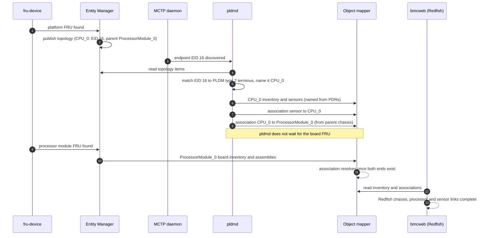
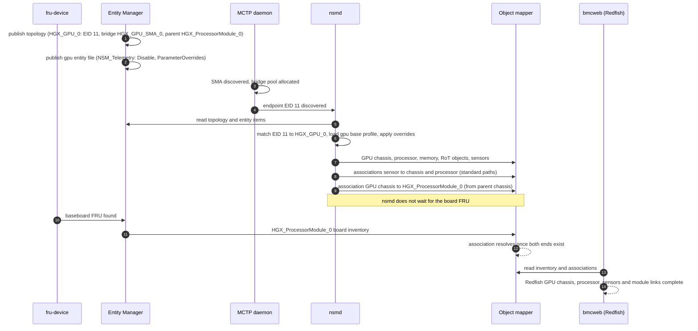

# Inventory data flow

How a device named in the platform topology becomes a complete Redfish
inventory, and which component creates each piece. The consuming applications
(pldmd, nsmd and the other backend daemons) read the topology; they do not wait
for each other or for the board FRU.

There is one flow per telemetry daemon: the PLDM Telemetry Flow (a CPU of a
compute tray BMC) and the NSMD Telemetry Flow (a GPU of an HGX baseboard). Items
marked † depend on daemon code that is not written yet or not yet run on a
device.

## Who creates what

| Piece                                                       | Created by        | Input                                                                                                                                  |
| ----------------------------------------------------------- | ----------------- | -------------------------------------------------------------------------------------------------------------------------------------- |
| Topology record (device names, EIDs, parent chassis)        | Entity Manager    | Platform topology file, published when its probe matches                                                                               |
| Board inventory (processor module, its assemblies)          | Entity Manager    | Board file, published when the board FRU is found                                                                                      |
| MCTP endpoint, bridge pool endpoints                        | MCTP daemon       | Discovery on the transport                                                                                                             |
| PLDM device terminus, its sensors, its Redfish names        | pldmd †           | Topology (`Name`, `EID`) plus the PDRs of the terminus                                                                                 |
| NSM device chassis, processor, memory, sensors, RoT objects | nsmd †            | Topology (`Kind`, `Generation`, `Instance`, `EID`), the base profile in the code and the entity file (`Disable`, `ParameterOverrides`) |
| Sensor-to-device and device-to-parent associations          | pldmd † or nsmd † | Topology (`Name`, `ParentChassis`) and the standard object paths                                                                       |
| Redfish chassis, processor and sensor resources             | bmcweb            | D-Bus inventory and associations                                                                                                       |

Entity Manager owns inventory only for boards found by FRU. A device found over
a protocol, such as a CPU or a GPU, gets its inventory from its daemon
(guideline 4).

## PLDM Telemetry Flow

Example: the CPU of a compute tray BMC.

1. **Topology is published.** The platform topology record is matched by the
   platform FRU. A platform without a usable FRU uses probe `TRUE`. The record
   carries one `NvDevice` item per device. For `CPU_0` this is `Kind: cpu`,
   `Instance: 0`, `EID: 16`, `ParentChassis: ProcessorModule_0` and the USB
   transport. `CPU_1` is the same with EID 17.
2. **MCTP discovers the endpoints.** The MCTP daemon brings up EID 16 and 17 on
   the USB transport. This does not depend on Entity Manager.
3. **pldmd matches the topology to the terminus.** pldmd reads the `NvDevice`
   items, finds the PLDM type 2 (platform monitoring) terminus with the same EID
   in the MCTP discovery, and names it from the topology: EID 16 is `CPU_0`. †
4. **Sensors are named and associated.** The sensors that pldmd discovers from
   the terminus PDRs belong to `CPU_0`. pldmd gives them their Redfish names and
   creates the association between each sensor and the `CPU_0` device. †
5. **The device is linked to its parent.** pldmd reads `ParentChassis` from the
   topology and creates the association from `CPU_0` to the processor module
   `ProcessorModule_0`. The object path is derived from the type and name, so
   pldmd does not look for the board object first (guideline 8). †
6. **The board inventory is created independently.** When fru-device finds the
   processor module FRU, Entity Manager publishes the board record from the
   board file: the processor module object and its assemblies. This can happen
   before or after steps 3 to 5.
7. **The links complete themselves.** The object mapper reports an association
   once both of its paths exist. When the board object appears, the link from
   `CPU_0` to `ProcessorModule_0` becomes visible without any daemon waiting for
   it. bmcweb then serves the Redfish resources with their links.

## NSMD Telemetry Flow

Example: a GPU of an HGX baseboard. `HGX_GPU_0` is reached through a GPU SMA on
USB, so its endpoint comes from the SMA's bridge pool.

1. **Topology is published.** The topology record carries the `NvDevice` item
   for `HGX_GPU_0`: `Kind: gpu`, `Generation: vr`, `Instance: 0`,
   `EID: 11`, `ParentChassis: HGX_ProcessorModule_0` and a bridge transport
   (`HGX_GPU_SMA_0`, pool index 0). The entity file for the `gpu` kind is
   published for every matching `NvDevice`. Its `NSM_Telemetry` item lists only
   what differs from the base profile (`Disable`, `ParameterOverrides`).
2. **MCTP brings up the endpoints.** The SMA `HGX_GPU_SMA_0` is discovered over
   USB and allocates its bridge pool. The GPU endpoint EID 11 appears in that
   pool.
3. **nsmd matches the topology to the endpoint.** nsmd reads the `NvDevice`
   items, finds the NSM device that answers on EID 11 and ties it to `HGX_GPU_0`
   by `Kind` and `Instance`. †
4. **The object set comes from the base profile.** nsmd selects the base profile
   for `gpu` and `vr`, which holds every feature of the device switched
   on. It applies `Disable` and `ParameterOverrides` from the entity file, then
   creates what remains: the GPU chassis, the processor, the PCIe device, the
   memory, the RoT objects and the sensors (temperature, power, energy,
   voltage). †
5. **Associations inside the device are derived.** nsmd links each sensor to the
   GPU chassis and to the processor, and the processor to the chassis, using the
   standard object paths for the kind and instance (`chassis/HGX_GPU_0`,
   `accelerator/HGX_GPU_0`). No association path is written in EM config
   (guideline 8). †
6. **The device is linked to its parent.** nsmd reads `ParentChassis` from the
   topology and associates the GPU chassis with `HGX_ProcessorModule_0`. It does
   not wait for the board object. †
7. **The board inventory is created independently.** When fru-device finds the
   baseboard FRU, Entity Manager publishes the board record for
   `HGX_ProcessorModule_0` from the board file. This can happen before or after
   steps 3 to 6.
8. **The links complete themselves.** The object mapper reports each association
   once both ends exist. bmcweb then serves the GPU chassis, its processor, its
   sensors and the processor module with their links.

## Properties of the flows

- **One source for names and parents.** The device name, the EID and the parent
  are written once, in the topology. pldmd, nsmd and the board files all use
  that fact and never repeat it (guideline 1).
- **The daemon owns the device, EM owns the board.** The device objects and
  their sensors come from the daemon that talks to the device. Entity Manager
  creates only the FRU-found board they hang from.
- **No ordering between daemons.** The topology, the MCTP endpoint and the board
  FRU can appear in any order. A device whose EID is not yet discovered keeps no
  inventory. A device whose parent board is not yet found keeps a dormant
  association that resolves when the board appears.
- **Redfish is complete when all three inputs exist.** The topology record names
  the device, the daemon gives it telemetry, and the board file gives its parent
  chassis. Each input has one owner.
- **Missing inputs degrade, not break.** Without a topology match, pldmd keeps
  the PLDM default names and has no parent link, and nsmd creates nothing for
  the endpoint. Without the board FRU, the device and its sensors are present in
  Redfish without the parent chassis they belong to.
- **The difference between the two daemons.** pldmd takes the sensors and their
  count from the terminus PDRs and only names and associates them. nsmd builds
  the object set from the base profile of the kind and generation, so the entity
  file lists only the deviation from that profile.
